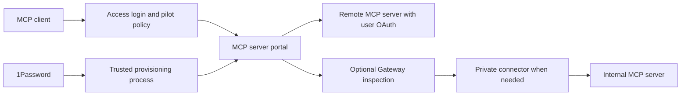

# Cloudflare MCP gateway setup plan

Prepared 2026-10-21. Scope: design and execution plan; cloud deployment is a subsequent implementation task. Owner: d3tech for account decisions and review; current Codex session for planning. One writer; no harness worker dispatched.

## Decision and architecture

Use Cloudflare One MCP server portals as the initial managed gateway. Prefer this to maintaining a custom proxy Worker unless a pilot demonstrates a missing requirement. Clients connect to a dedicated pilot hostname, authenticate through Access, and use a restricted set of remote MCP tools. Require each user to authenticate to OAuth upstreams; avoid shared administrative authority for business data.

Cloudflare documents a single portal endpoint, per-user upstream OAuth, manual OAuth clients, tool filtering, and optional Gateway routing. Portal visibility policies do not stop direct connections to public upstream URLs. Customer-owned origins need their own enforced authorization or private routing; third-party bypass prevention needs managed endpoint egress controls plus provider permissions. Gateway routing requires Streamable HTTP. Portal server authorization does not enforce independent MFA, purpose justification, or temporary authentication. Use IdP MFA and test the chosen policy path. [Cloudflare portal documentation](https://developers.cloudflare.com/cloudflare-one/access-controls/ai-controls/mcp-portals/).

## Current evidence and unknowns

- Local repository origin is `d3-corp/cf-mcp-gw`; initial remote HEAD/main lookup returned no refs. A bootstrap main branch has now been pushed. Coordinator repository permissions and mapping remain unverified.
- Cloudflare connection lists one account, named d3. Existing portal `mcp-portal` uses `portal.d3adc3ii.cc`; its detail response has `servers: []`. The documentation MCP server is registered separately. Assess existing policy/DNS and reuse the portal only after owner confirmation; registration alone proves no working gateway. No cloud configuration has been changed.
- Planning issue: D3S-69, assigned to d3tech. This workspace is not automatically issue-linked; use the explicit identifier.
- 1Password CLI exists. No local 1Password MCP tools are exposed in this session. No credentials, Environment IDs, or vault access have been verified.
- Actual target hostname, approved account, IdP/group, upstream URLs, clients, data classifications, retention, budget, and operational owner remain inputs for implementation. Do not infer these from available domains or account access.

## Implementation sequence

1. **Inventory and approval.** Record each upstream's URL, owner, transport, OAuth support, scopes, permitted tool names, data sensitivity, and direct-access exposure. Select a pilot client, authorized user, unauthorized user, and harmless read-only tool. Confirm Cloudflare entitlement and cost before enabling paid features. Acceptance: reviewed inventory and explicit account/domain/pilot selection.
2. **Repository and harness onboarding.** Use the private repository and pushed main branch. Review the plan PR. Add the repository and chosen Linear project to the coordinator allowlists using its existing add-repository procedure. Register required documentation/link/secret checks in administrator configuration; do not accept shell commands from ticket text. Run configuration validation and read-only doctor. Acceptance: permissions, branch, project mapping, check IDs, and preflight evidence recorded.
3. **Secrets setup.** Create separate pilot and production 1Password scopes as described below. Provision a narrowly scoped Cloudflare automation token and upstream OAuth client credentials only when required. Acceptance: names-only verification, owner/expiry metadata and service restart authentication evidence; no values in Git or Linear.
4. **Pilot configuration.** Inspect the existing portal, Access application/policies, IdP and DNS first. Reuse the existing hostname if approved, or create a dedicated pilot hostname. Configure an Access policy restricted to the pilot group. Register one approved remote server. Enable per-user auth and explicitly allow only approved tools; resynchronize and inspect new capabilities before expanding access. Confirm DNS/TLS, callback URLs, OAuth scopes and user consent in the real client. Acceptance: authorized end-to-end read succeeds and unauthorized access fails.
5. **Additional security paths.** For private upstreams, configure connector/routes and test origin reachability before adding the server. If Gateway inspection is required, pilot transport and synthetic DLP tests first. For public third-party upstreams, document residual direct-access risk and establish endpoint egress enforcement if the requirement is gateway-only access. Acceptance: direct-origin test matches the declared security boundary.
6. **Operations and rollout.** Add servers individually after tests. Document tool-change review, credential rotation, session/token revocation, upstream failures, alert ownership and rollback. Pilot for an agreed observation window, then seek rollout review. Acceptance: evidence on the exact deployed configuration, operator runbook, review signoff.

## 1Password secret-management design

Use 1Password as the authoritative administrative secret store. Use separate least-privilege scopes for Cloudflare provisioning, upstream registration and the harness coordinator. Keep the coordinator's existing Linear/GitHub/inference credentials separate from gateway credentials. Coding and verification containers receive no gateway deployment secrets.

Suggested names (not provisioned): `CLOUDFLARE_API_TOKEN`, upstream-specific `*_OAUTH_CLIENT_SECRET`, and optional connector or service-token credentials. Store non-secret account IDs, URLs and client IDs in reviewed configuration when appropriate. Record owner, expiry, purpose and rotation date with each credential.

For attended Environment setup, enable the local 1Password MCP server and use names-only tools to select the Environment and verify variable names. The desktop client requires user approval. For unattended provisioning, use a dedicated read-only 1Password service account, with its bootstrap credential supplied by the service manager's protected credential facility. Never commit that bootstrap credential or pass secrets as command-line arguments.

A trusted provisioning process may resolve `op://` references with `op run` for the duration of a subprocess. Do not echo environment variables, request bodies, tokens or OAuth callbacks. Check response status and resource IDs instead. Disable HTTP debug tracing. [1Password secret references](https://www.1password.dev/cli/secret-references), [service accounts](https://www.1password.dev/service-accounts).

The managed portal still needs runtime credential/token storage at Cloudflare. 1Password governs administrative credential custody and rotation; it does not replace the portal's OAuth token lifecycle. If the requirement forbids Cloudflare custody, revisit the architecture before deployment. On rotation, update 1Password and the consuming configuration, validate a harmless request, revoke the previous credential, then confirm its rejection. Reauthenticate user OAuth through the provider rather than exporting refresh tokens into repository files.

## Verification and rollback

| Gate | Required evidence before production rollout |
| --- | --- |
| Identity | Authorized pilot succeeds; outsider and removed-group user denied; MFA and applicable posture failures tested |
| Upstream isolation | Two users retain distinct provider permissions; revoked/expired tokens fail; shared admin access is disabled for sensitive tools |
| Tool restriction | Approved read succeeds; disallowed tool absent and direct invocation denied; newly added upstream tool remains unapproved |
| Protocol | Actual target client completes initialization, listing and invocation; reconnect and expiry behave correctly |
| Bypass | Customer-owned direct origin rejects access; third-party residual risk or tested endpoint restrictions recorded |
| Secrets | No values in Git, logs, task output or state artifacts; scoped service identity and rotation/revocation verified |
| Audit | Authentication and tool-call evidence correlated without storing sensitive arguments; retention and log access approved |
| Failure | Upstream outage, connector loss and credential expiry fail safely; recovery and rollback demonstrated |

Rollback: restrict the pilot policy to stop new access, revoke active portal/provider sessions using the supported controls, disconnect the affected upstream and restore the previous reviewed configuration. Validate access is denied. Preserve logs and checkpoints; do not delete shared DNS, tunnels, policies or state databases. Any deletion requires a separately reviewed resource list.

## Linear harness contract

Use the existing harness workflow: issue scope and criteria, dependency gates, one execution owner, coordinator-pushed checkpoint, independent configured verification, structured HANDOFF, draft PR and In Review. Human review controls merge and Done. The current planning session is manual; creating a ticket alone does not prove a harness run.

Repository onboarding is tracked by D3S-70 (HARNESS-ONBOARDING.md). Subsequent implementation ticket stages: secret-access preflight; pilot configuration/runbook; live acceptance and rollout review. Keep deployment credentials out of coding workers. Harness should prepare configuration and documentation; a trusted operator/provisioner applies reviewed cloud changes and records live evidence separately.

Do not queue until the coordinator mapping and its exact required check IDs exist. Then include a `harness` JSON block with repository key `cf-mcp-gw`, selected configured checks, Linux platform and explicit acceptance criteria. Move to Todo and add `harness:ready` only after prerequisites and blockers are satisfied. The coordinator owns publication/state changes for an actual dispatched run. See the local harness's `docs/add-repository.md` and `docs/agent-contract.md`.

Planning acceptance: this document covers architecture, trust boundaries, prerequisites, staged execution, 1Password custody, harness dispatch gates, live verification and rollback; it is recorded in Linear with a handoff and left for review. Live gateway deployment is not a planning acceptance claim.
