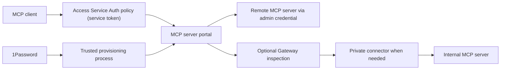

# Cloudflare MCP gateway setup plan

Prepared 2026-10-21. Scope: design and execution plan; cloud deployment is a subsequent implementation task. Owner: d3tech for account decisions and review; current Codex session for planning. One writer; no harness worker dispatched.

## Decision and architecture

Use Cloudflare One MCP server portals as the initial managed gateway. Prefer this to maintaining a custom proxy Worker unless a pilot demonstrates a missing requirement. Clients connect to a dedicated pilot hostname and authenticate only with the Access service token admitted by a single Service Auth policy; there is no identity-provider Allow policy, and OAuth sign-in is not accepted. The client uses a restricted set of remote MCP tools.

Clients authenticate to the portal only with a Cloudflare Access service token, sending the CF-Access-Client-Id and CF-Access-Client-Secret request headers; a single Service Auth policy on the portal's Access application admits only that service token. Each linked MCP server's Access application has a Service Auth policy for the same token and Require user auth turned off. The portal reaches each upstream with a non-OAuth admin credential (a bearer token or custom headers, held in 1Password), or unauthenticated when the upstream is reachable only privately. Servers that require per-user OAuth (on_behalf: true) are excluded from service-token sessions and are not linked.

Cloudflare documents a single portal endpoint, per-user upstream OAuth, manual OAuth clients, tool filtering, and optional Gateway routing. Portal visibility policies do not stop direct connections to public upstream URLs. Customer-owned origins need their own enforced authorization or private routing; third-party bypass prevention needs managed endpoint egress controls plus provider permissions. Gateway routing requires Streamable HTTP. Portal server authorization does not enforce independent MFA, purpose justification, or temporary authentication. Use IdP MFA and test the chosen policy path. [Cloudflare portal documentation](https://developers.cloudflare.com/cloudflare-one/access-controls/ai-controls/mcp-portals/).

## Current evidence and unknowns

- Local repository origin is `d3-corp/cf-mcp-gw`; initial remote HEAD/main lookup returned no refs. A bootstrap main branch has now been pushed. Coordinator repository permissions and mapping remain unverified.
- Cloudflare connection lists one account, named d3. Existing portal `mcp-portal` uses `portal.d3adc3ii.cc`; its detail response has `servers: []`. The documentation MCP server is registered separately. Assess existing policy/DNS and reuse the portal only after owner confirmation; registration alone proves no working gateway. No cloud configuration has been changed.
- Planning issue: D3S-69, assigned to d3tech, in Agent Workflow Pilot. The user reconfirmed d3space/D3S after an account switch; verified setup IDs are in LINEAR-MIGRATION.md. This workspace is not automatically issue-linked; use the explicit identifier.
- 1Password CLI exists. No local 1Password MCP tools are exposed in this session. No credentials, Environment IDs, or vault access have been verified.
- Actual target hostname, approved account, service token owner and expiry, upstream URLs, clients, data classifications, retention, budget, and operational owner remain inputs for implementation. Do not infer these from available domains or account access.

## Implementation sequence

1. **Inventory and approval.** Record each upstream's URL, owner, transport, non-OAuth authentication option (admin bearer token, custom headers or private unauthenticated access), permitted tool names, data sensitivity, and direct-access exposure. Select a pilot client, the service-token client, and a harmless read-only tool. Confirm Cloudflare entitlement and cost before enabling paid features. Acceptance: reviewed inventory and explicit account/domain/pilot selection.
2. **Repository and harness onboarding.** Use the private repository and pushed main branch. Review the plan PR. Add the repository and chosen Linear project to the coordinator allowlists using its existing add-repository procedure. Register required documentation/link/secret checks in administrator configuration; do not accept shell commands from ticket text. Run configuration validation and read-only doctor. Acceptance: permissions, branch, project mapping, check IDs, and preflight evidence recorded.
3. **Secrets setup.** Create separate pilot and production 1Password scopes as described below. Provision a narrowly scoped Cloudflare automation token and upstream admin bearer credentials only when required. Acceptance: names-only verification, owner/expiry metadata and service restart authentication evidence; no values in Git or Linear.
4. **Pilot configuration.** Inspect the existing portal, Access applications/policies and DNS first. Reuse the existing hostname if approved, or create a dedicated pilot hostname. Configure a single Service Auth policy for the service token on the portal's Access application and on the linked server's Access application, with no identity-provider Allow policy. Register one approved remote server with Require user auth off and an admin-credential (non-OAuth) upstream auth, and explicitly allow only approved tools; resynchronize and inspect new capabilities before expanding access. Confirm DNS/TLS and that the real client sends only the service-token headers. Acceptance: the service-token client completes an end-to-end read; no token, a wrong token and a revoked token are denied; and an OAuth attempt (dynamic client registration plus a browser sign-in) grants no access.
5. **Additional security paths.** For private upstreams, configure connector/routes and test origin reachability before adding the server. If Gateway inspection is required, pilot transport and synthetic DLP tests first. For public third-party upstreams, document residual direct-access risk and establish endpoint egress enforcement if the requirement is gateway-only access. Acceptance: direct-origin test matches the declared security boundary.
6. **Operations and rollout.** Add servers individually after tests. Document tool-change review, credential rotation, service-token revocation, upstream failures, alert ownership and rollback. Pilot for an agreed observation window, then seek rollout review. Acceptance: evidence on the exact deployed configuration, operator runbook, review signoff.

## 1Password secret-management design

Use 1Password as the authoritative administrative secret store. Use separate least-privilege scopes for Cloudflare provisioning, upstream registration and the harness coordinator. Keep the coordinator's existing Linear/GitHub/inference credentials separate from gateway credentials. Coding and verification containers receive no gateway deployment secrets.

Suggested names (not provisioned): `CLOUDFLARE_API_TOKEN`, upstream-specific admin bearer credentials, the portal service token and optional connector credentials. Store non-secret account IDs, URLs and client IDs in reviewed configuration when appropriate. Record owner, expiry, purpose and rotation date with each credential.

For attended Environment setup, enable the local 1Password MCP server and use names-only tools to select the Environment and verify variable names. The desktop client requires user approval. For unattended provisioning, use a dedicated read-only 1Password service account, with its bootstrap credential supplied by the service manager's protected credential facility. Never commit that bootstrap credential or pass secrets as command-line arguments.

A trusted provisioning process may resolve `op://` references with `op run` for the duration of a subprocess. Do not echo environment variables, request bodies or tokens. Check response status and resource IDs instead. Disable HTTP debug tracing. [1Password secret references](https://www.1password.dev/cli/secret-references), [service accounts](https://www.1password.dev/service-accounts).

The portal service token's client ID and client secret are held in the 1Password item recorded in Linear D3S-118 and are resolved only at runtime by the client or by a trusted provisioning process; they are never written to Git, Linear, command lines or logs, and the item records the token's owner, expiry and rotation date. To rotate the service token, create a new service token, update 1Password, validate a harmless read-only tool call, revoke the old token, then confirm the old token is rejected. A service token is a shared machine identity, so tool calls made with it are not attributable to a person; limit it to approved tools. Every upstream call runs as the admin credential, so per-user upstream permissions no longer apply.

The managed portal still needs runtime credential storage at Cloudflare. Cloudflare stores the upstream admin credentials at runtime; 1Password governs administrative credential custody and rotation. If the requirement forbids Cloudflare custody, revisit the architecture before deployment. On rotation, update 1Password and the consuming configuration, validate a harmless request, revoke the previous credential, then confirm its rejection.

## Verification and rollback

| Gate               | Required evidence before production rollout                                                                                                                                             |
| ------------------ | --------------------------------------------------------------------------------------------------------------------------------------------------------------------------------------- |
| Identity           | Service-token client succeeds; no token, wrong token, revoked token and an OAuth sign-in attempt are denied                                                                             |
| Upstream isolation | Every linked server has Require user auth off and a non-OAuth admin credential; revoked/expired credentials fail; only approved tools are reachable through the shared admin credential |
| Tool restriction   | Approved read succeeds; disallowed tool absent and direct invocation denied; newly added upstream tool remains unapproved                                                               |
| Protocol           | Actual target client completes initialization, listing and invocation; reconnect and expiry behave correctly                                                                            |
| Bypass             | Customer-owned direct origin rejects access; third-party residual risk or tested endpoint restrictions recorded                                                                         |
| Secrets            | No values in Git, logs, task output or state artifacts; scoped service identity and rotation/revocation verified                                                                        |
| Audit              | Authentication and tool-call evidence correlated without storing sensitive arguments; retention and log access approved                                                                 |
| Failure            | Upstream outage, connector loss and credential expiry fail safely; recovery and rollback demonstrated                                                                                   |

Rollback: restrict the pilot policy to stop new access, revoke the service token and active portal sessions using the supported controls, disconnect the affected upstream and restore the previous reviewed configuration. Validate access is denied. For the service-token path, revoke the service token and remove the Service Auth policy, then confirm requests presenting the token are denied. Preserve logs and checkpoints; do not delete shared DNS, tunnels, policies or state databases. Any deletion requires a separately reviewed resource list.

## Contract Master workflow

File current work as an issue in the Cloudflare MCP Gateway Linear project with exactly one `repo:cf-mcp-gw` label and one complete `contract-master` JSON block. The block contains all six fields: `repo_id` (`d3-corp/cf-mcp-gw`), the full 40-character `base_commit`, `goal`, `allowed_scope`, `acceptance_criteria` and `required_checks`. `required_checks` selects the registered IDs `typecheck`, `docs`, `secrets` and `tests` by ID; the commands behind those IDs come from administrator configuration, and an issue never supplies commands. [AGENTS.md](AGENTS.md) and [README.md](README.md) hold the current repository guidance. Issues missing any of this stay unqueued until clarified.

Claude investigates the issue and code, records a bounded plan and confirms final acceptance on the merged commit. DeepSeek implements the plan and runs the tests. Codex independently verifies the exact output commit, reviews the pull request and merges it. Only the Contract Master manager writes Linear workflow updates such as comments, state changes and HANDOFF. Humans handle escalations such as unresolved verification or scope disputes. A task moves to Done only after the Codex merge and Claude's final confirmation, not when a pull request is opened or checks pass.

The former `harness` JSON block with repository key `cf-mcp-gw`, the procedure of moving an issue to Todo and adding the `harness:ready` label, and repository onboarding through D3S-70 with [HARNESS-ONBOARDING.md](HARNESS-ONBOARDING.md) belong to the earlier Linear harness workflow. They are historical records kept for context, not instructions for current work. Current work no longer uses that procedure.

Contract Master tasks prepare documentation and review-only configuration in this repository. Deployment credentials stay out of coding workers. A trusted operator applies reviewed Cloudflare changes and records live acceptance evidence separately, under its own approval. Creating an issue, passing the offline checks, or merging a documentation pull request does not prove gateway deployment or live acceptance. The later ticket stages remain the staged path: secret-access preflight; pilot configuration and runbook; live acceptance and rollout review. This document covers architecture, trust boundaries, prerequisites, staged execution, 1Password custody, the Contract Master workflow gates, live verification and rollback; live gateway deployment is not a planning acceptance claim.
